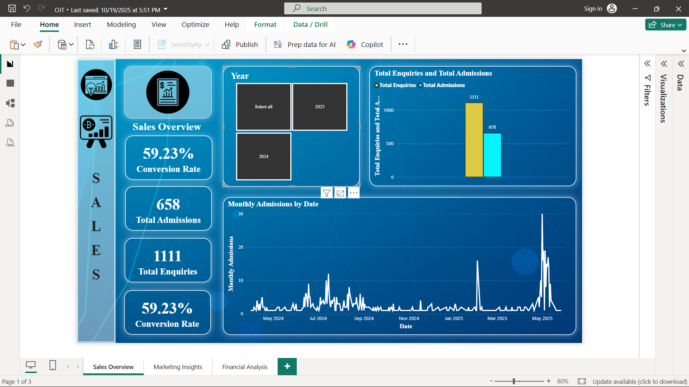
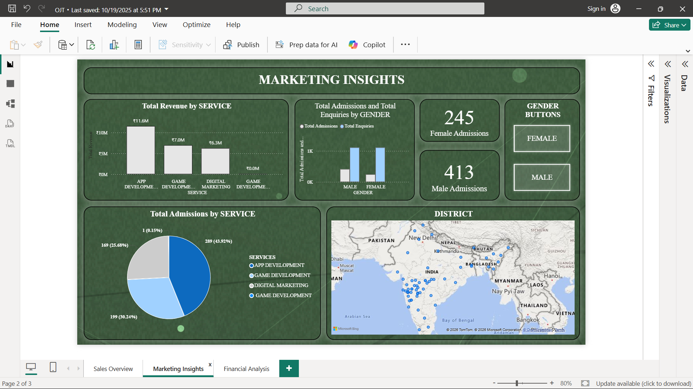
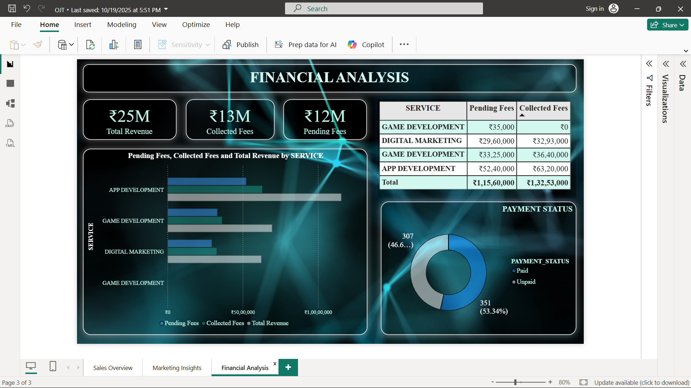

# Sales & Marketing Analysis: Enquiry to Admission Funnel


On-the-Job Training project (Business Analytics intern, MBA 2024-2026)
at a Pune-based IT training and services company.

## Dashboards

### 1. Sales Overview
Enquiries vs admissions, conversion rate and trends across services,
gender and districts.



### 2. Marketing Insights
Performance of marketing channels: which sources bring the most enquiries,
admissions and revenue.



### 3. Financial Analysis
Total fees, collected vs pending amounts and payment status by service.



## Problem Statement
The company received enquiries through many channels but had no clear view
of how many became admissions, which channels and courses brought the most
revenue, and how much fee money was still pending.

## Objectives
- Measure the enquiry-to-admission conversion rate
- Compare marketing channels, courses, gender and districts
- Track fee collection (collected vs pending)
- Find peak months and enquiries that need follow-up
- Present the results in three Power BI dashboards

## Dataset
Two tables linked by `STUD_ID` (April 2024 to May 2025):
- **Enquiry data:** 1,111 records (date, service, district, gender, source)
- **Admission data:** 658 records (the above plus total fees and
  installments)

Student names and addresses are masked for privacy.

## Approach
1. Loaded the data into MySQL, set data types and keys
   (primary key on enquiries, foreign key on admissions)
2. Added `Balance` and `Payment_Status` columns with SQL
3. Wrote SQL queries for conversion, source, service, revenue, gender,
   district, monthly trends and follow-up lists
4. Built three Power BI dashboards (Sales, Marketing, Financial) with DAX
   measures

## Key Findings
| Metric | Result |
|--------|--------|
| Total enquiries | 1,111 |
| Total admissions | 658 |
| Conversion rate | **59.2%** |
| Total fees billed | ₹2.48 crore |
| Fees collected | ₹1.33 crore |
| Fees pending | ₹1.16 crore |

- **Top channel:** Instagram brings the most enquiries (375 under
  "Instagram" alone, before counting variants like "Insta" and combined
  entries)
- **Top course:** App Development leads in admissions (289) and revenue
  (₹1.16 crore), followed by Game Development and Digital Marketing
- **Gender gap:** conversion is about 64% for male enquiries versus about
  52% for female enquiries
- **Location:** Pune has the most admissions (244)
- **Fee collection:** about 46% of billed fees are still pending
- **Follow-up:** 453 enquiries have not converted and can be re-contacted

## Recommendations
- Invest more in Instagram and Google, and improve referral programs
- Follow up on unconverted enquiries to recover missed admissions
- Run targeted outreach to improve conversion among female enquirers
- Set up reminders for pending installments
- Time campaigns around peak enquiry months

## Data Quality Notes
- Source labels are inconsistent (for example "Insta" and "Instagram"),
  so channel counts depend on how labels are grouped
- Admissions are matched to enquiries using `STUD_ID`

## Project Structure
```
├── sql/OJT_project.sql                  # All SQL queries
├── data/                            # CSV files
├── report/OJT_Project_Report.pdf
├── presentation/On-the-Job-Training-Presentation.pptx
├── images/
│   ├── Sales_Overview_Dashboard.png
│   ├── Marketing_Insights_Dashboard.png
│   └── Financial_Analysis_Dashboard.png
└── README.md
```

## How to Run
1. Open MySQL Workbench and import the two CSV files from `data/` using the
   Table Data Import Wizard, naming the tables `ADMISSIONDATABASE` and
   `ENQUIREDATABASE` (the SQL script renames them).
2. Run `sql/NMD_OJT.sql` step by step.
